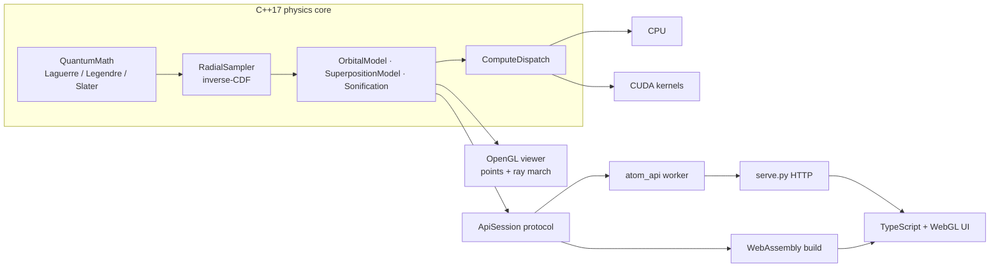

# Quantum Orbital Simulator

[](https://github.com/Jeanm2005/particle-simulator/actions/workflows/ci.yml)


[](LICENSE)

Interactive 3D simulator of electron orbitals built on exact solutions of the
Schrödinger equation. One C++17 physics core drives a native OpenGL viewer, a
local TypeScript web app, and an in-browser WebAssembly build, with optional
CUDA acceleration.

## Highlights

- **Exact hydrogenic physics for any element.** Radial and angular wavefunctions
  are sampled by inverse-CDF. Charge is either nuclear Z or Slater-screened
  Z<sub>eff</sub>, using element data for Z = 1–118 audited against CIAAW and NIST.
- **Time-dependent dynamics.** Probability-current flow, plus normalized
  two-orbital superpositions whose density beats at the Bohr frequency.
- **GPU rendering and compute.** Point-cloud and volumetric ray-marching shaders.
  CUDA kernels handle sampling and flow, and fall back to the CPU at build time
  and at runtime.
- **Density sonification.** Turns an orbital's radial density into audio and
  exports it as WAV. Each radial node is heard as a silence.
- **Three front ends, one core.** The OpenGL desktop viewer, the local web UI
  (HTTP to a native worker) and the static WebAssembly demo all share the same
  validated `ApiSession` protocol.
- **Tested.** 12 CTest suites, offscreen shader image regressions, HTTP transport
  tests and Playwright browser tests run in GitHub Actions. Tagged builds publish
  checksummed Linux packages.

## Measured results

RTX 5080 Laptop GPU under WSL2. Medians of warmed runs that include allocations
and transfers.

| Particles | CPU sampling | CUDA sampling | Speedup |
|---:|---:|---:|---:|
| 50,000 | 7.9 ms | 1.1 ms | 7.5× |
| 500,000 | 78.6 ms | 6.8 ms | 11.5× |
| 1,000,000 | 164.9 ms | 18.7 ms | 8.8× |

Ray marching a full 1280×720 frame at 256 steps took 1.7–3.8 ms per frame for
states up to n = 7. Each image matches a 4096-step reference within a maximum
RGB error of 0.005. Flow updates that copy results back to the host are
currently slower on the GPU than on the CPU. Keeping buffers on the device is
planned.

## Quick start

Requires CMake 3.16+ and a C++17 compiler. The desktop viewer also needs GLFW,
GLEW, GLM and OpenGL. Without them, CMake builds console mode.

```bash
sudo apt install build-essential cmake libglfw3-dev libglew-dev libglm-dev libgl1-mesa-dev
cmake -S . -B build
cmake --build build -j
ctest --test-dir build --output-on-failure
```

```bash
./build/atom_sim --visual      # OpenGL viewer
./build/atom_sim --console     # headless; writes an .xyz point cloud
```

Web app (Python 3.10+, Node.js 22+):

```bash
npm --prefix web ci && npm --prefix web run build
python3 tools/serve.py --binary build/atom_api   # open http://127.0.0.1:8000
```

Viewer keys: drag to orbit, scroll to zoom, `N/B` `L/K` `M/J` change n, l, m,
`P` toggles probability flow, `T` toggles ray marching, `R` resamples.

## Architecture



| Path | Responsibility |
|---|---|
| `src/QuantumMath.cpp`, `src/RadialSampler.cpp` | Wavefunctions, screening, CDF sampling |
| `src/OrbitalModel.cpp`, `src/Superposition.cpp` | Validated request/result models |
| `src/Sonification.cpp` | Radial density scan and WAV encoding |
| `src/ComputeDispatch.cpp`, `cuda/` | CPU/CUDA dispatch with runtime fallback |
| `src/Engine.cpp`, `include/RaytraceShaders.hpp` | OpenGL point and ray-march rendering |
| `src/ApiSession.cpp`, `tools/serve.py` | Line protocol, loopback HTTP server |
| `web/` | TypeScript UI, WebAssembly worker, Playwright tests |

## Physics model

- **Wavefunctions.** ψ<sub>nlm</sub> = R<sub>nl</sub>(r) Y<sub>l</sub><sup>m</sup>(θ, φ),
  for n ≤ 7 and l ≤ 3. Coordinates are in Bohr radii, with Y as the polar axis.
- **Energy.** E<sub>n</sub> = −13.6 Z<sub>eff</sub><sup>2</sup> / n<sup>2</sup> eV.
  This is exact for one-electron ions. Slater screening is an approximation.
- **Probability current.** Samples rotate about Y with v = m / (r sin θ),
  which preserves both radius and height.
- **Superpositions.** Two distinct eigenstates of one pure-Z Hamiltonian, each
  with n ≤ 4, evolve through their relative energy phase.
- **Sonification.** The scan maps r from 0 to 15n²/Z<sub>eff</sub> onto the
  clip's duration. A fixed-pitch tone's amplitude follows the normalized
  r²|R<sub>nl</sub>|², so the clip contains n − l − 1 silences. The output is
  16-bit mono WAV. This is a mapping of the data; orbitals do not emit audible
  sound.

Not modeled: relativistic effects, spin, external fields, electron-electron
correlation. For quantitative chemistry, use a Hartree–Fock or DFT package.

## Testing and CI

`ctest` runs the physics, screening, sampling, model, superposition,
sonification, dispatch, CUDA-parity, console, installation and HTTP-transport
suites, plus EGL shader image checks when available. `npm test` in `web/` runs
the browser suite. GitHub Actions builds console, OpenGL, CUDA (CPU-fallback)
and WebAssembly targets. Pushing a `v*` tag publishes tested Linux packages to
Releases.

## Roadmap

- [x] Exact orbitals, Slater screening, element database audit
- [x] OpenGL point cloud, ray marching, probability current
- [x] CUDA sampling/flow with measured parity and performance
- [x] TypeScript UI, local JSON transport, WebAssembly demo
- [x] Two-orbital time-dependent interference
- [x] Orbital density sonification and WAV export
- [ ] Sonification of interference and additional basis states
- [ ] Device-resident CUDA buffers and CUDA/OpenGL interop
- [ ] Additional validated physics models, such as lattice phonons

## Acknowledgments

The visualization approach was inspired by
[kavan010/Atoms](https://github.com/kavan010/Atoms).

## License

[MIT](LICENSE)
