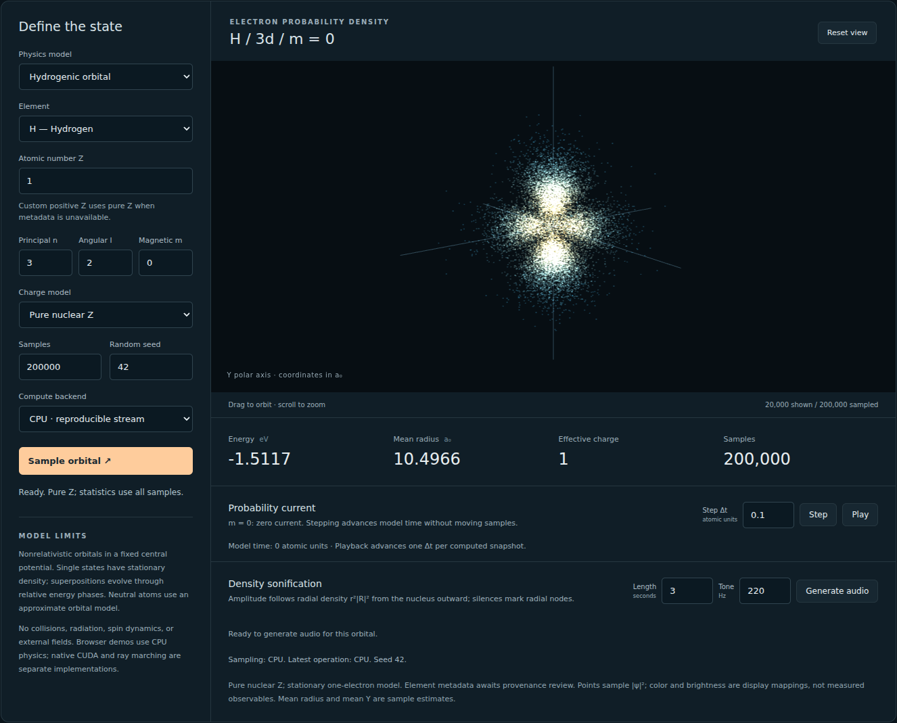
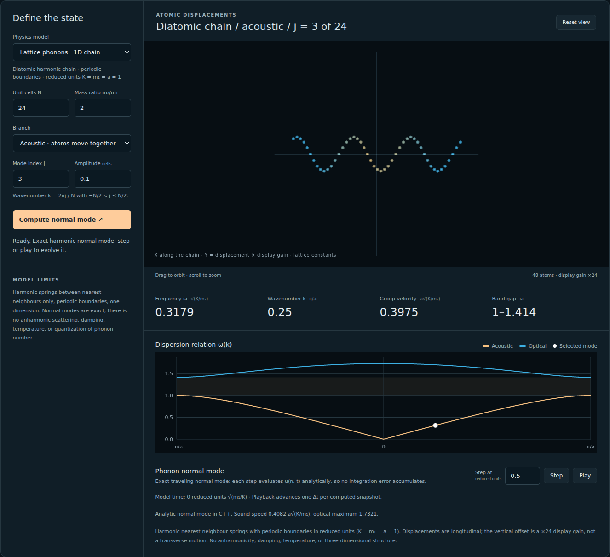
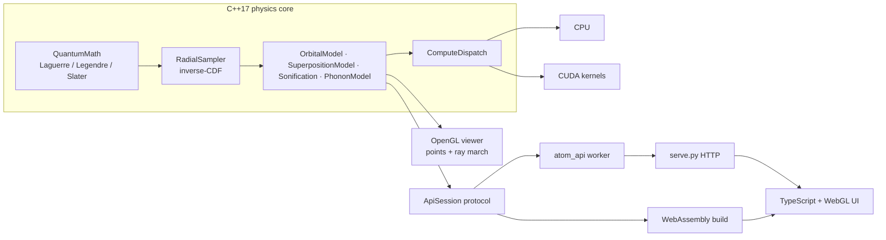

# Quantum Orbital & Lattice Simulator

[](https://github.com/Jeanm2005/particle-simulator/actions/workflows/ci.yml)


[](LICENSE)

Interactive simulator of electron orbitals and lattice vibrations built on exact
solutions: the hydrogenic Schrödinger equation and the normal modes of a
harmonic crystal. One C++17 physics core drives a native OpenGL viewer, a local
TypeScript web app, and an in-browser WebAssembly build, with optional CUDA
acceleration.

| Hydrogen 3d orbital (200k samples) | Diatomic-chain phonon and dispersion |
|---|---|
|  |  |

## Highlights

- **Exact hydrogenic physics for any element.** Radial and angular wavefunctions
  are sampled by inverse-CDF. Charge is either nuclear Z or Slater-screened
  Z<sub>eff</sub>, using element data for Z = 1–118 audited against CIAAW and NIST.
- **Time-dependent dynamics.** Probability-current flow, plus normalized
  two-orbital superpositions whose density beats at the Bohr frequency.
- **Lattice phonons.** Acoustic and optical normal modes of a 1D diatomic
  crystal. The UI shows a live dispersion plot, the band gap and the group
  velocity, and the atoms evolve exactly in time.
- **GPU rendering and compute.** Point-cloud and volumetric ray-marching shaders.
  CUDA kernels handle sampling and flow on persistent device buffers, and fall
  back to the CPU at build time and at runtime.
- **Sonification.** Turns an orbital's radial density into audio, with each
  radial node heard as a silence. Superpositions play their oscillating dipole
  at a pitch proportional to the Bohr frequency. Both export as WAV.
- **Three front ends, one core.** The OpenGL desktop viewer, the local web UI
  (HTTP to a native worker) and the static WebAssembly demo all share the same
  validated `ApiSession` protocol.
- **Tested.** 13 CTest suites, offscreen shader image regressions, HTTP transport
  tests and Playwright browser tests run in GitHub Actions. Tagged builds publish
  checksummed Linux packages.

## Measured results

RTX 5080 Laptop GPU under WSL2, CUDA 13.4. Medians of 7 warmed runs measured
at the application dispatch boundary, so validation and host↔device transfers
are included.

| Particles | CPU sampling | CUDA sampling | CPU flow step | CUDA flow step |
|---:|---:|---:|---:|---:|
| 50,000 | 11.2 ms | 0.8 ms | 0.8 ms | 0.8 ms |
| 500,000 | 104.2 ms | 4.2 ms | 11.3 ms | 4.2 ms |
| 1,000,000 | 222.8 ms | 8.9 ms | 31.8 ms | 10.9 ms |

At 1M particles, CUDA sampling is 25× faster than the CPU and a flow step is
2.9× faster. Persistent device buffers and on-device validation cut the GPU flow
step from 42 ms to 11 ms. Run `compute_tests --benchmark` to reproduce. Ray
marching a full 1280×720 frame at 256 steps took 1.7–3.8 ms for states up to
n = 7. Each frame matches a 4096-step reference within a maximum RGB error of
0.005.

## Quick start

Requires CMake 3.16+ and a C++17 compiler. The desktop viewer also needs GLFW,
GLEW, GLM and OpenGL. Without them, CMake builds console mode.

```bash
sudo apt install build-essential cmake libglfw3-dev libglew-dev libglm-dev libgl1-mesa-dev
cmake -S . -B build
cmake --build build -j
ctest --test-dir build --output-on-failure
```

```bash
./build/atom_sim --visual      # OpenGL viewer
./build/atom_sim --console     # headless; writes an .xyz point cloud
```

Web app (Python 3.10+, Node.js 22+):

```bash
npm --prefix web ci && npm --prefix web run build
python3 tools/serve.py --binary build/atom_api   # open http://127.0.0.1:8000
```

Viewer keys: drag to orbit, scroll to zoom, `N/B` `L/K` `M/J` change n, l, m,
`P` toggles probability flow, `T` toggles ray marching, `R` resamples.

## Architecture



| Path | Responsibility |
|---|---|
| `src/QuantumMath.cpp`, `src/RadialSampler.cpp` | Wavefunctions, screening, CDF sampling |
| `src/OrbitalModel.cpp`, `src/Superposition.cpp` | Validated request/result models |
| `src/Sonification.cpp` | Density scan, transition dipoles, interference audio, WAV |
| `src/PhononModel.cpp` | Diatomic-chain dispersion, polarization, exact mode evolution |
| `src/ComputeDispatch.cpp`, `cuda/` | CPU/CUDA dispatch with runtime fallback |
| `src/Engine.cpp`, `include/RaytraceShaders.hpp` | OpenGL point and ray-march rendering |
| `src/ApiSession.cpp`, `tools/serve.py` | Line protocol, loopback HTTP server |
| `web/` | TypeScript UI, WebAssembly worker, Playwright tests |

## Physics model

- **Wavefunctions.** ψ<sub>nlm</sub> = R<sub>nl</sub>(r) Y<sub>l</sub><sup>m</sup>(θ, φ),
  for n ≤ 7 and l ≤ 3. Coordinates are in Bohr radii, with Y as the polar axis.
- **Energy.** E<sub>n</sub> = −13.6 Z<sub>eff</sub><sup>2</sup> / n<sup>2</sup> eV.
  This is exact for one-electron ions. Slater screening is an approximation.
- **Probability current.** Samples rotate about Y with v = m / (r sin θ),
  which preserves both radius and height.
- **Superpositions.** Two distinct eigenstates of one pure-Z Hamiltonian, each
  with n ≤ 4, evolve through their relative energy phase. Transition dipoles
  ⟨a|y|b⟩ are computed by quadrature and match tabulated hydrogen values within
  0.2%. The exact ⟨y⟩(t) agrees with the sampled clouds for six state pairs.
- **Sonification.** The scan maps r from 0 to 15n²/Z<sub>eff</sub> onto the
  clip's duration. A fixed-pitch tone's amplitude follows the normalized
  r²|R<sub>nl</sub>|², so the clip contains n − l − 1 silences. For a
  superposition, the waveform follows ⟨y⟩(t). Its pitch scales with
  |E<sub>2</sub> − E<sub>1</sub>|, and hydrogen 1s+2p plays at the base tone.
  Pairs with no dipole coupling, which selection rules forbid, are silent.
  Output is 16-bit mono WAV. These are mappings of the data; orbitals do not
  emit audible sound.

- **Lattice phonons.** A diatomic chain with nearest-neighbour springs and
  periodic boundaries, in reduced units K = m₁ = a = 1. Its dispersion is
  ω²<sub>±</sub> = s ± √(s² − 4 sin²(k/2)/m₂), with s = 1 + 1/m₂. The
  dispersion matches the eigenvalues of the full 2N×2N dynamical matrix to
  1e-9. A velocity-Verlet integration of the entire chain reproduces the
  analytic modes, with energy conserved to 1e-6. The monatomic, band-gap and
  sound-speed limits are checked against their closed forms.

Not modeled: relativistic effects, spin, external fields, electron-electron
correlation, and anharmonic lattice effects. For quantitative chemistry, use a
Hartree–Fock or DFT package.

## Testing and CI

`ctest` runs the physics, screening, sampling, model, superposition,
sonification, lattice-phonon, dispatch, CUDA-parity, console, installation and HTTP-transport
suites, plus EGL shader image checks when available. `npm test` in `web/` runs
the browser suite. GitHub Actions builds console, OpenGL, CUDA (CPU-fallback)
and WebAssembly targets. Pushing a `v*` tag publishes tested Linux packages to
Releases.

## Roadmap

- [x] Exact orbitals, Slater screening, element database audit
- [x] OpenGL point cloud, ray marching, probability current
- [x] CUDA sampling/flow with measured parity and performance
- [x] TypeScript UI, local JSON transport, WebAssembly demo
- [x] Two-orbital time-dependent interference
- [x] Orbital density sonification and WAV export
- [x] Interference sonification and validation of additional state pairs
- [x] Device-resident CUDA buffers with transactional on-device validation
- [ ] CUDA/OpenGL interop, so the viewer draws GPU-resident clouds without host copies
- [x] Validated 1D diatomic lattice phonon model with dispersion visualization
- [ ] 2D/3D lattices, phonon density of states, and anharmonic coupling

## Acknowledgments

The visualization approach was inspired by
[kavan010/Atoms](https://github.com/kavan010/Atoms).

## License

[MIT](LICENSE)
